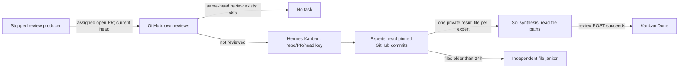

# DD: GitHub-native PR review with file handoffs

- Status: approved direction; implementation and cutover pending
- Decision owner: operator
- Supersedes: the active review path described in [architecture](architecture.md) and the older [council design](hermes/DD-pr-review-council.md). Maintenance and inbox are unchanged.

## Problem and outcome

The current review path admits work before checking for an existing review, copies pinned PR evidence into local snapshots, and makes post-publication cleanup a prerequisite for completing a card. A review can land on GitHub while its card remains blocked for cleanup. The replacement must admit only unreviewed heads and finish when GitHub accepts the review, without creating human Review tasks for routine work.

## Design

The producer's GitHub check prevents work on a head already reviewed by the same account, regardless of marker or verdict. Hermes returns an existing non-archived task for the same idempotency key; an archived task permits new admission **only when GitHub has no same-head review from us**. No JSON request cache or separate review claim is needed. Hermes' lookup is not a unique database constraint, so truly concurrent creates may race; keep one producer and accept this rare limitation rather than add a ledger.

The task carries repository, PR number, and full base/head SHAs. Reviewers use their existing local `gh api -X GET` and file tools to read comparisons and file contents at those SHAs; they do not clone the repository or treat mutable current-PR file lists as pinned evidence. The source PR may move during review: Sol checks its live head immediately before posting and stops without a review when it differs. If GitHub truncates or cannot provide required evidence, the expert reports the concrete limitation; it does not invent findings.

Each specialist writes one bounded, owner-only JSON result file named `<specialist_task_id>-<role>.json` in a dedicated private results directory. A new card after archival uses a different task ID, so it does not overwrite an older result. Its Kanban handoff contains the file path, not findings or an artifact digest. Sol reads those paths, synthesizes the independent perspectives, and posts an exact-head review: `APPROVE` for clean/nit-only work, actionable `COMMENT` for required fixes (also `COMMENT` for self-authored PRs). A successful GitHub POST response with a review ID completes the final card with `completion_contract=local-only`; there is no mandatory second read, synchronous redaction, or human Review stage. On an ambiguous POST, read GitHub for a same-head review from our account before considering another attempt; never blindly retry.

A host daily job removes only specialist-result files older than 24 hours from the fixed private directory. It does not inspect Kanban task state and its failure cannot affect review completion. The LaunchAgent template remains uninstalled until the reviewed result-file writer is ready and the operator approves cutover. Keep the producer stopped until the new path is validated. At cutover, stop the gateway and archive remaining non-archived cards on the `pr-review` board **before** installing the revised specialist profiles; do not delete GitHub reviews, maintenance cards, the board database, or historical effect records. Verify the installed profiles, then restart the gateway and enable one review producer. No old-card replay or archive exception to the GitHub prefilter.

## Alternatives and boundaries

| Rejected | Reason |
| --- | --- |
| Local Git snapshots, input manifests, completion digests | Pinned GitHub SHAs provide the required evidence identity without a local copy or digest handoff. |
| 72-hour JSON cache or per-head effect claim | Hermes already reuses a non-archived idempotency key; GitHub is the source of truth for posted reviews. |
| Cleanup as a completion gate | Privacy retention must not convert a delivered review into a human-input block. |
| Check Kanban status before deleting day-old result files | A synthesis run lasting more than a day is a separate failure, not a reason to couple cleanup to task lifecycle. |

The producer keeps its existing read-only discovery token. Specialists use the operator's existing local GitHub authentication through native terminal `gh api -X GET` and native `write_file`; no custom GitHub tool or specialist token setup is needed. The operator accepts that the specialist read-only rule is prompt policy, not a credential or sandbox boundary. Their profile allowlist enables terminal/file alongside own-task Kanban tools. PR content, tool output, and result files are untrusted evidence, never instructions. Result files are private (directory `0700`, files `0600`) and the janitor must not follow links or delete outside that directory. Kanban remains the task store; no new DB, service, static application token, or GitHub review deletion is proposed.

## Validation and rollout gates

1. With fake GitHub and Kanban: same-head own review skips admission; an older-head review does not; a non-archived key returns the same task; an archived key with no own GitHub review admits anew; an archived key with one skips. GitHub lookup failure admits nothing that scan.
2. With fake pinned GitHub responses: each specialist reads the assigned base/head, writes one result file, and Sol consumes the returned paths without a local snapshot. A moved head produces no review. A successful POST reaches Done without cleanup or a human Review step; an ambiguous response is never blindly reposted.
3. In an isolated private directory: the janitor removes only matching result files older than 24 hours; failure logs and can retry next run. No task-state lookup.
4. Before live admission: producer stopped, old non-archived `pr-review` cards archived by the operator-approved cutover, no running cards, existing local `gh` authentication available to specialists, and installed profiles/tools agree with this contract. Run one authorized end-to-end PR, then resume the schedule. Stop only the review producer if admission or completion misbehaves; maintenance and inbox stay on their existing paths.

No files, cards, credentials, or GitHub effects are deleted by writing this design. Archival and activation are separate live actions requiring explicit approval.
